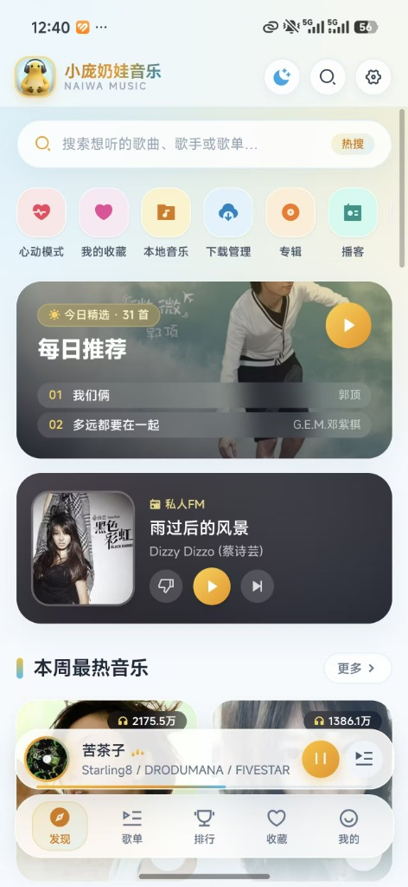
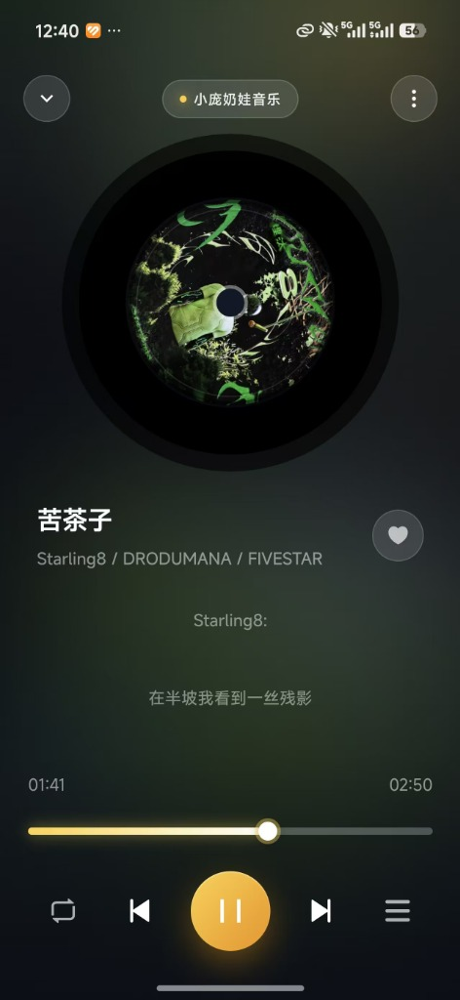

<p align="center">
  
</p>

<h1 align="center">小庞奶娃音乐 · Android / iOS / PWA 跨平台版</h1>

<p align="center">
  基于开源音乐播放器 <a href="https://github.com/algerkong/AlgerMusicPlayer/releases/tag/v5.1.0">algerkong/AlgerMusicPlayer v5.1.0</a> 构建的 <b>Vue 3 + AndroidX Media3 + iOS Swift AVPlayer 三端同源移动端音乐播放器学习项目</b>
</p>

<p align="center">
  <a href="https://github.com/erryp8126-source/XiaoPangNaiwaMusic/releases/latest">
    
  </a>
  <a href="https://github.com/erryp8126-source/XiaoPangNaiwaMusic/releases/latest">
    
  </a>
  <a href="https://erryp8126-source.github.io/XiaoPangNaiwaMusic/">
    
  </a>
  <a href="docs/DEVELOPMENT.md">
    
  </a>
  <a href="LICENSE">
    
  </a>
</p>

---

## 实机界面预览

<table>
  <tr>
    <td align="center" width="33%">
      
      <br />
      <sub><b>发现主页 · 奶娃暖阳风</b></sub>
    </td>
    <td align="center" width="33%">
      
      <br />
      <sub><b>全屏黑胶播放页</b></sub>
    </td>
    <td align="center" width="33%">
      
      <br />
      <sub><b>沉浸同步歌词页</b></sub>
    </td>
  </tr>
</table>

---

## 三端能力对照

| 功能特性 | Android 原生版 (`.apk`) | iOS 原生版 (`.ipa`) | Safari PWA 在线版 |
| --- | :---: | :---: | :---: |
| **「奶娃暖阳治愈风」浅色/深色双模 UI** | 支持 | 支持 | 支持 |
| **全屏黑胶播放器 + 左右滑切歌 / 下拉收起** | 支持 | 支持 | 支持 |
| **内置本地回环直连服务 (`127.0.0.1:30488`)** | 支持 (`NanoHTTPD`) | 支持 (`NWListener`) | 需配置远程 API 地址 |
| **息屏后台播放 & 锁屏/蓝牙/耳机播控** | 支持 (`Media3 ExoPlayer`) | 支持 (`AVPlayer` + `MediaPlayer`) | 依赖浏览器前台 |
| **熄屏原生队列自动无缝切歌** | 支持（多曲预排无断流） | 支持（后台预解析连播） | 基础支持 |
| **网易云风格双行逐字桌面歌词（含翻译/配色/字号/锁定）** | 支持 | 系统限制暂不支持 | 不支持 |
| **桌面 4×1 音乐播控小组件（专辑封面 + 切歌控制）** | 支持 (`AppWidget`) | 暂不支持 | 不支持 |
| **原生 200MB 边听边缓存（常听秒开省流量）** | 支持 (`SimpleCache`) | 系统缓冲 | 浏览器缓存 |
| **10 段原生硬件均衡器 (EQ)** | 支持 (`audiofx.Equalizer`) | 暂不支持（安全直出） | 网页直出 |
| **本地音频扫描 & 离线下载管理** | 支持 (`MediaStore`) | 支持（iPhone「文件」导入） | 不支持 |
| **应用内检查更新 & 固定签名覆盖升级** | 支持 | 跳转 Release 下载 | 自动在线更新 |

---

## 项目简介与核心特性

### 1. 「奶娃暖阳治愈风」统一三端 UI
- **暖阳琥珀金 × 晴空冰蓝主题体系**：默认高对比度精致浅色卡片界面，支持顶栏一键切换浅色 / 深色模式。
- **沉浸播放器与直觉手势**：悬浮胶囊底部 5 项导航栏、黑胶迷你播控条、极光流光全屏播放器、封面区**左滑下一首 / 右滑上一首 / 下拉收起**、全条 44px 触控跟手进度条、逐字歌词与翻译、倍速播放与定时关闭。
- **单前端三端共享**：一套 `upstream/` Vue 3 移动端源码同时驱动 **Android 原生 APK**、**iOS 原生 Swift IPA** 与 **Safari PWA 在线版**。

### 2. Android 原生壳（Kotlin + Media3 ExoPlayer + NanoHTTPD）
- 基于 **AndroidX Media3 ExoPlayer + MediaSession** 前台服务，支持熄屏后台播放、过渡期 WakeLock 保活、**原生多曲无缝预排队列自动切歌**、锁屏/蓝牙播控、点击通知栏切回前台状态无缝回同步（不暂停不回跳）。
- **网易云风格双行逐字桌面歌词**：纯净无底框透明悬浮、YRC/LRC 卡拉OK逐字扫色、点击展开半透明播控与 5 色配色球、`T+`/`T-` 字号调节、`译` 双语翻译开关、触摸穿透锁定与通知栏/设置页一键解锁。
- **10 段原生硬件均衡器 (EQ) + 200MB 边听边缓存**：播放页抽屉一键呼出 10 段均衡器与风格预设；内置 Media3 `SimpleCache` 200MB LRU 磁盘缓存（常听歌曲秒开、支持在设置页查看占用与一键清理）。
- **Android 4×1 桌面音乐小组件**：桌面卡片实时展示专辑封面、歌名、歌手与上一首/播放暂停/下一首控键，配合逐层返回键栈体验媲美原生大厂音乐应用。
- 内置 Kotlin 本地回环适配层（`127.0.0.1:30488`）、MediaStore 本地音频扫描与离线下载，且已配置固定正式签名证书（本地与云端 APK 签名一致，支持覆盖升级）。

### 3. iOS 原生壳（纯 Swift + AVPlayer + Network.NWListener）
- **零第三方依赖**，全部基于 Apple 原生系统框架（`UIKit` / `WebKit` / `AVFoundation` / `MediaPlayer` / `CommonCrypto` / `CryptoKit` / `Network` / `CoreImage`），最低支持 **iOS 15.0+**。
- 开启 `AVAudioSession (.playback)` 后台音频模式 + `MPRemoteCommandCenter` / `MPNowPlayingInfoCenter` 锁屏、控制中心与 AirPods 播控，并内置 **Swift 原生后台自动切歌队列引擎**。
- 内置纯 Swift 本地回环服务（`127.0.0.1:30488`），支持扫码/Cookie/UID 登录与离线下载，同时开启 `UIFileSharingEnabled`，可直接在 iPhone「文件」App 中拖入 MP3/FLAC/M4A 歌曲播放。

### 4. iPhone Safari PWA 免签在线版
- 已自动托管至 GitHub Pages：**https://erryp8126-source.github.io/XiaoPangNaiwaMusic/**
- 在 iPhone Safari 打开上方链接，点击「分享 → 添加到主屏幕」即可免证书全屏使用，并在「设置 → 网络」填写自定义 API 服务地址。

---

## 目录结构

```text
XiaoPangNaiwaMusic/
├── upstream/        # Vue 3 + TypeScript + Tailwind CSS 三端共享前端源码
├── android/         # Kotlin + Media3 ExoPlayer + NanoHTTPD Android 原生工程
├── ios/             # 纯 Swift + AVPlayer + NWListener iOS 原生工程 (XcodeGen)
├── docs/            # 开发者技术文档 (DEVELOPMENT.md) 与实机运行截图
├── .github/workflows/# GitHub Actions 云端自动编译发布 Android APK + iOS IPA + PWA + GitHub Pages
├── build_apk.ps1    # Windows 一键本地编译 Android APK 脚本
└── build_pwa.ps1    # Windows 一键本地导出 Safari PWA 静态包脚本
```

> 架构设计、JS ↔ 原生桥接协议、内置本地回环服务、后台无缝连播机制、正式签名配置与 CI/CD 踩坑指南，详见完整 **[开发者技术文档（docs/DEVELOPMENT.md）](docs/DEVELOPMENT.md)**。

---

## 构建与安装指南

### Android 端（`.apk`）
- **直接安装**：前往 [Releases 页面](https://github.com/erryp8126-source/XiaoPangNaiwaMusic/releases/latest) 下载最新版 `.apk` 直接安装（支持 Android 8.0+）。
- **本地构建**（Windows，需 Node.js 18+、JDK 17、Android SDK API 35）：
  ```powershell
  .\build_apk.ps1
  ```

### iOS 端（`.ipa`）
1. **直接下载 `.ipa`**：前往 [Releases 页面](https://github.com/erryp8126-source/XiaoPangNaiwaMusic/releases/latest) 直接下载云端编好的 **`XiaoPangNaiwaMusic-v5.1.1-unsigned.ipa`**（支持 iOS 15.0+）。
2. **GitHub Actions 云端重新编译**（无需 Mac）：
   - 进入仓库 **Actions → Build & Release Android + iOS + PWA → Run workflow**，约 4 分钟即可自动编出最新的 Android APK、iOS IPA 与 PWA 并同步发布。
3. **Mac 本地编译**（需 Xcode 15+ 与 `brew install xcodegen`）：
   ```bash
   cd upstream && npm install --ignore-scripts --legacy-peer-deps && npx vite build --outDir "$(pwd)/../ios/XiaoPangNaiwaMusic/Resources/www" --emptyOutDir
   cd ../ios && xcodegen generate && open XiaoPangNaiwaMusic.xcodeproj
   ```
4. **iPhone 安装 `.ipa`**：
   - 使用 **Sideloadly**、**爱思助手**、**AltStore / SideStore**（免费 Apple ID 自签，每 7 天续签）或 **TrollStore 巨魔商店**（永久免签）将 `.ipa` 签装到 iPhone 即可。

### Safari PWA 在线版 / 自托管
- 直接访问在线版：**https://erryp8126-source.github.io/XiaoPangNaiwaMusic/**
- 或本地导出静态包自托管：
  ```powershell
  .\build_pwa.ps1
  ```

---

## 开源协议与免责声明

- 本项目基于 [algerkong/AlgerMusicPlayer](https://github.com/algerkong/AlgerMusicPlayer)（MIT License）进行移动端技术研究与界面改造，同样遵循 [MIT License](LICENSE) 开源。
- **免责声明**：本项目仅用于 Vue 3、Android Media3 与 iOS Swift AVFoundation 跨平台混合开发技术学习与交流，不提供任何商业服务。请尊重音乐版权，支持正版音乐平台，下载测试后请于 24 小时内删除。
