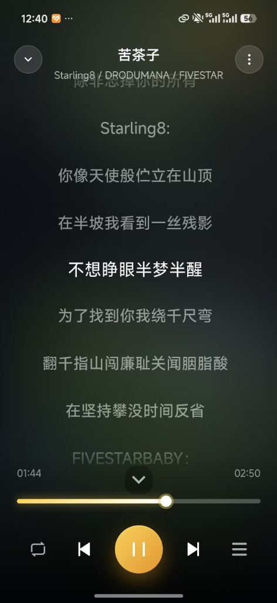

<p align="center">
  
</p>

<h1 align="center">小庞奶娃音乐 · Android / iOS / PWA 跨平台版</h1>

<p align="center">
  基于开源音乐播放器 <a href="https://github.com/algerkong/AlgerMusicPlayer/releases/tag/v5.1.0">algerkong/AlgerMusicPlayer v5.1.0</a> 构建的 <b>Vue 3 + AndroidX Media3 + iOS Swift AVPlayer 双端同源移动端音乐播放器学习项目</b>
</p>

<p align="center">
  <a href="https://github.com/erryp8126-source/XiaoPangNaiwaMusic/releases/latest">
    
  </a>
  <a href="https://github.com/erryp8126-source/XiaoPangNaiwaMusic/releases/latest">
    
  </a>
  <a href="LICENSE">
    
  </a>
</p>

---

## 实机界面预览

<table>
  <tr>
    <td align="center" width="33%">
      
      <br />
      <sub><b>发现主页 · 奶娃暖阳风</b></sub>
    </td>
    <td align="center" width="33%">
      
      <br />
      <sub><b>全屏黑胶播放页</b></sub>
    </td>
    <td align="center" width="33%">
      
      <br />
      <sub><b>沉浸同步歌词页</b></sub>
    </td>
  </tr>
</table>

---

## 项目简介与功能特性

### 1. 「奶娃暖阳治愈风」统一双端 UI
- **暖阳琥珀金 × 晴空冰蓝主题体系**：默认高对比度精致浅色卡片界面，支持顶栏一键切换浅色 / 深色模式。
- **悬浮磨砂玻璃导航与沉浸播放器**：悬浮胶囊底部 5 项图文导航栏、黑胶迷你播控条、极光流光全屏播放器、全条 44px 触控跟手进度条（带拖拽时间预览气泡）、逐字歌词与翻译、倍速播放与定时关闭。
- **单前端三端共享**：一套 `upstream/` Vue 3 移动端源码同时驱动 **Android 原生 APK**、**iOS 原生 Swift IPA** 与 **Safari PWA 网页模式**。

### 2. Android 原生壳（Kotlin + Media3 ExoPlayer + NanoHTTPD）
- 基于 **AndroidX Media3 ExoPlayer + MediaSession** 前台服务，支持熄屏后台播放、过渡期 WakeLock 保活、**后台原生队列自动切歌**、锁屏/蓝牙播控、CBR/VBR 全流精准拖拽 Seek。
- 内置 Kotlin 本地回环适配层（`127.0.0.1:30488`）、10 段硬件均衡器（`android.media.audiofx.Equalizer`）、MediaStore 本地音频扫描与离线下载、桌面悬浮歌词窗。

### 3. iOS 原生壳（纯 Swift + AVPlayer + Network.NWListener）
- **零第三方依赖**，全部基于 Apple 原生系统框架（`UIKit` / `WebKit` / `AVFoundation` / `MediaPlayer` / `CommonCrypto` / `CryptoKit` / `Network` / `CoreImage`），最低支持 **iOS 15.0+**。
- 开启 `AVAudioSession (.playback)` 后台音频模式 + `MPRemoteCommandCenter` / `MPNowPlayingInfoCenter` 锁屏、控制中心与 AirPods 播控，并内置 **Swift 原生后台自动切歌队列引擎**，息屏后无需依赖 WebView 即可自动连播下一首。
- 内置纯 Swift 本地回环服务（`127.0.0.1:30488`），支持扫码/Cookie/UID 登录与离线下载，同时开启 `UIFileSharingEnabled`，可直接在 iPhone「文件」App 中拖入 MP3/FLAC/M4A 歌曲播放。

### 4. iPhone Safari PWA 免签模式
- 完整支持 `manifest.json`、`apple-touch-icon`、全屏状态栏与安全区适配、离线静态资源 Service Worker。
- 部署 `releases/pwa` 静态目录后，在 iPhone Safari 打开并点击「分享 → 添加到主屏幕」即可免证书全屏使用，并可在「设置 → 网络」填写自定义 API 服务地址。

---

## 目录结构

```text
XiaoPangNaiwaMusic/
├── upstream/        # Vue 3 + TypeScript + Tailwind CSS 双端共享前端源码
├── android/         # Kotlin + Media3 ExoPlayer + NanoHTTPD Android 原生工程
├── ios/             # 纯 Swift + AVPlayer + NWListener iOS 原生工程 (XcodeGen)
├── docs/screenshots/# 实机运行截图
├── .github/workflows/# GitHub Actions 云端自动编译并发布 Android APK + iOS IPA + PWA
├── build_apk.ps1    # Windows 一键本地编译 Android APK 脚本
└── build_pwa.ps1    # Windows 一键本地导出 Safari PWA 静态包脚本
```

---

## 构建与安装指南

### Android 端（.apk）
- **直接安装**：前往 [Releases 页面](https://github.com/erryp8126-source/XiaoPangNaiwaMusic/releases/latest) 下载 `.apk` 直接安装（支持 Android 8.0+）。
- **本地构建**（Windows，需 Node.js 18+、JDK 17、Android SDK API 35）：
  ```powershell
  .\build_apk.ps1
  ```

### iOS 端（.ipa）
1. **直接下载 `.ipa`**：前往 [Releases 页面](https://github.com/erryp8126-source/XiaoPangNaiwaMusic/releases/latest) 直接下载云端编好的 **`XiaoPangNaiwaMusic-v5.1.0-unsigned.ipa`**（支持 iOS 15.0+）。
2. **GitHub Actions 云端重新编译**（无需 Mac）：
   - 进入仓库 **Actions → Build & Release Android + iOS + PWA → Run workflow**，约 4 分钟即可自动编出最新的 Android APK、iOS IPA 与 PWA 压缩包并同步更新 Release。
3. **Mac 本地编译**（需 Xcode 15+ 与 `brew install xcodegen`）：
   ```bash
   cd upstream && npm install --ignore-scripts --legacy-peer-deps && npx vite build --outDir "$(pwd)/../ios/XiaoPangNaiwaMusic/Resources/www" --emptyOutDir
   cd ../ios && xcodegen generate && open XiaoPangNaiwaMusic.xcodeproj
   ```
4. **iPhone 安装 `.ipa`**：
   - 使用 **Sideloadly**、**爱思助手**、**AltStore / SideStore**（免费 Apple ID 自签，每 7 天续签）或 **TrollStore 巨魔商店**（永久免签）将 `.ipa` 签装到 iPhone 即可。

### Safari PWA 静态包
```powershell
.\build_pwa.ps1
```
将生成的 `releases/pwa/` 目录托管到任意 HTTPS 静态空间（如 Cloudflare Pages / Vercel / GitHub Pages），在 iPhone Safari 打开后选择「添加到主屏幕」即可。

---

## 开源协议与免责声明

- 本项目基于 [algerkong/AlgerMusicPlayer](https://github.com/algerkong/AlgerMusicPlayer)（MIT License）进行移动端技术研究与界面改造，同样遵循 [MIT License](LICENSE) 开源。
- **免责声明**：本项目仅用于 Vue 3、Android Media3 与 iOS Swift AVFoundation 跨平台混合开发技术学习与交流，不提供任何商业服务。请尊重音乐版权，支持正版音乐平台，下载测试后请于 24 小时内删除。
