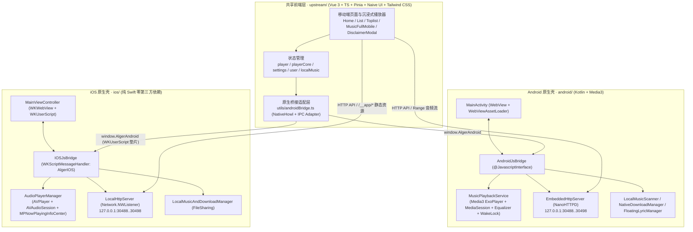
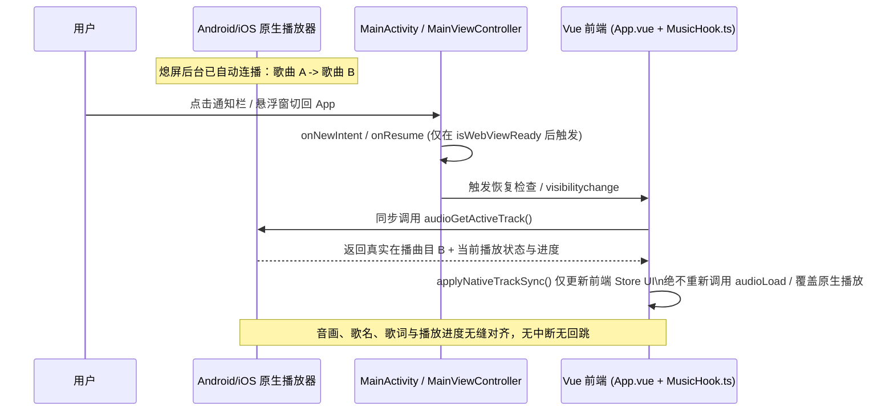

# 小庞奶娃音乐 · 开发者技术文档（DEVELOPMENT）

本文档面向参与二次开发、调试与打包维护的开发者，系统梳理 **小庞奶娃音乐（Android / iOS / Safari PWA 三端同源）** 的架构设计、JS ↔ 原生桥接协议、内置本地回环服务、后台无缝连播音频引擎、UI 主题规范以及双端自动化 CI/CD 流水线。

---

## 1. 整体架构总览

本项目基于开源项目 `algerkong/AlgerMusicPlayer v5.1.0` 深度改造，采用 **「单套 Vue 3 移动端前端 + 双端同源原生外壳（Kotlin / Swift）+ 纯前端 PWA 降级模式」** 架构：

- **Android 端**通过 `WebView` + `WebViewAssetLoader` 加载本地前端资源，并注入原生对象 `window.AlgerAndroid`。
- **iOS 端**通过 `WKWebView` 加载内置本地 HTTP 服务器托管的前端资源（`http://127.0.0.1:<port>/__app/index.html`），并在文档执行前通过 `WKUserScript` 注入**与 Android 100% 接口一致**的 `window.AlgerAndroid` 垫片（同时标记 `window.__ALGER_PLATFORM__ = 'ios'`），从而让前端代码零分支差异地同时驱动双端。
- **Safari PWA 端**在无 `window.AlgerAndroid` 时自动回退到标准 Web 音频（Howler/HTML5 Audio）与用户配置的远程 API 地址。



---

## 2. 目录结构与核心模块说明

```text
XiaoPangNaiwaMusic/
├── upstream/                                  # Vue 3 双端共享前端工程（Vite root = src/renderer）
│   ├── vite.config.ts                         # Vite 构建配置（base: './', root: src/renderer）
│   ├── src/i18n/lang/zh-CN/                   # 中文文案（含 comp.ts 免责声明等）
│   └── src/renderer/
│       ├── App.vue                            # 根容器、Naive UI 浅/深主题覆盖、全局恢复钩子、DisclaimerModal
│       ├── utils/androidBridge.ts             # window.AlgerAndroid 协议封装、NativeHowl、异步 RPC、事件总线
│       ├── hooks/MusicHook.ts                 # 音频事件监听、原生曲目/状态同步 applyNativeTrackSync()
│       ├── services/audioService.ts           # 播放器抽象层（原生端委托 NativeHowl，Web 端走 Howler）
│       ├── store/modules/playerCore.ts        # 播放列表、播放模式、切歌队列同步 audioSyncQueue()
│       ├── components/common/DisclaimerModal.vue # 首次启动《使用须知》免责声明弹窗
│       └── components/player/MusicFullMobile.vue # 移动端黑胶全屏播放器与逐字歌词视图
│
├── android/                                   # Android 原生工程（Gradle + Kotlin, compileSdk=35, minSdk=26）
│   └── app/
│       ├── build.gradle.kts                   # 应用配置、versionCode、Media3 / OkHttp / NanoHTTPD 依赖
│       └── src/main/kotlin/com/alger/musicplayer/
│           ├── AlgerApp.kt                    # Application 入口：启动本地 HTTP 服务 + 预热匿名 Cookie
│           ├── MainActivity.kt                # Edge-to-Edge WebView、安全区注入、onNewIntent/onResume 状态同步
│           ├── bridge/AndroidJsBridge.kt      # window.AlgerAndroid 原生接口实现
│           ├── player/MusicPlaybackService.kt # 前台播放服务（ExoPlayer 多曲预排队列、锁屏控制、均衡器）
│           ├── server/
│           │   ├── EmbeddedHttpServer.kt      # NanoHTTPD 127.0.0.1 本地 API / 音频流 / 封面服务
│           │   ├── NeteaseApiClient.kt        # 80+ 网易云 API 路由与请求签名封装
│           │   ├── NeteaseCrypto.kt           # weapi / eapi / linuxapi 加密实现
│           │   └── MusicUnblockEngine.kt      # 多平台音源解析与无 CORS 原生 HTTP 代理
│           ├── local/LocalMusicScanner.kt     # MediaStore 音频扫描与元数据解析
│           ├── download/NativeDownloadManager.kt # 原生音乐/歌词下载管理
│           ├── lyric/FloatingLyricManager.kt  # Android 桌面悬浮歌词窗
│           └── config/AppPrefs.kt             # SharedPreferences 配置持久化
│
├── ios/                                       # iOS 原生工程（纯 Swift 5 + XcodeGen, iOS 15.0+）
│   ├── project.yml                            # XcodeGen 工程声明（含 CURRENT_PROJECT_VERSION、Resources/www）
│   └── XiaoPangNaiwaMusic/
│       ├── Info.plist                         # App 元数据（后台音频模式、文件共享、本地网络权限）
│       ├── AppDelegate.swift                  # 启动 LocalHttpServer、初始化 AppServices 与 AudioPlayerManager
│       ├── MainViewController.swift           # Edge-to-Edge WKWebView、安全区 CSS 变量注入、事件转发
│       ├── Bridge/IOSJsBridge.swift           # 注入 window.AlgerAndroid 垫片并处理 WKScriptMessageHandler
│       ├── Player/AudioPlayerManager.swift    # AVPlayer 后台播放、预解析缓存、锁屏/AirPods 控制
│       ├── Server/
│       │   ├── LocalHttpServer.swift          # Network.NWListener 本地 HTTP/1.1 服务（兼托管 /__app/*）
│       │   ├── NeteaseApiClient.swift         # Swift 网易云 API 客户端
│       │   ├── NeteaseCrypto.swift            # CommonCrypto / CryptoKit 加密实现
│       │   └── MusicUnblockEngine.swift       # Swift 多音源解锁与代理请求
│       ├── Storage/LocalMusicAndDownloadManager.swift # 本地文档目录扫描与离线下载
│       └── Config/AppPrefs.swift              # UserDefaults 配置持久化
│
├── docs/
│   ├── DEVELOPMENT.md                         # 本文档
│   └── screenshots/                           # 实机展示截图（home / player / lyrics）
├── .github/workflows/build-dual-platform.yml  # GitHub Actions 三端自动编译与 Release 发布流水线
├── build_apk.ps1                              # Windows 一键本地编译 Android Release APK
└── build_pwa.ps1                              # Windows 一键本地打包 Safari PWA 静态资源
```

---

## 3. JS ↔ 原生桥接协议（`window.AlgerAndroid`）

双端原生壳统一暴露 `window.AlgerAndroid` 对象（前端声明位于 [androidBridge.ts](../upstream/src/renderer/utils/androidBridge.ts)）。

### 3.1 平台识别

| 判断方式 | 含义 |
| --- | --- |
| `typeof window.AlgerAndroid !== 'undefined'` | 当前运行在原生 App（Android 或 iOS）内 |
| `window.__ALGER_PLATFORM__ === 'ios'` | 当前运行在 iOS `WKWebView` 内 |
| 无 `window.AlgerAndroid` 且非 Electron | 当前运行在 Safari PWA / 普通浏览器模式 |

### 3.2 同步方法清单

| 分组 | 方法签名 | 说明 |
| --- | --- | --- |
| **服务配置** | `getServerConfig(): string` | 读取 `local` / `custom` API 模式、端口、自定义地址、悬浮歌词开关 JSON |
| | `setServerConfig(json: string): string` | 持久化更新服务配置并返回生效配置 JSON |
| | `getLocalServerStatus(): string` | 查询本地回环服务运行状态、监听端口与匿名 Token 状态 |
| **音频控制** | `audioLoad(payloadJson: string)` | 加载并准备新曲目（含 `instanceId`、URL、标题/歌手/封面/时长、音量、倍速） |
| | `audioPlay()` / `audioPause()` / `audioStop()` | 控制原生播放、暂停与停止 |
| | `audioSeek(positionSec: number)` | 精准拖拽定位到指定秒数 |
| | `audioSetVolume(volume: number)` | 设置音量（`0.0 ~ 1.0`） |
| | `audioSetRate(rate: number)` | 设置倍速播放 |
| | `audioGetState(): string` | 同步返回当前播放实例 ID、位置、时长与播放状态 JSON |
| | `audioGetActiveTrack(): string` | **前台恢复关键接口**：同步返回原生端当前真实在播曲目（`songId`、元数据、播放进度与状态） |
| | `audioSyncQueue(queueJson: string)` | 同步完整播放列表、当前索引、播放模式、音质、解锁源与用户 Cookie 给原生端 |
| **硬件均衡器** | `eqSetEnabled(enabled: boolean)` | 开关 Android 硬件均衡器（`android.media.audiofx.Equalizer`） |
| | `eqSetBandGain(freqHz: number, gainDb: number)` | 调整指定频段增益 |
| | `eqReset()` | 重置所有频段增益 |
| **桌面歌词** | `setFloatingLyricEnabled(enabled: boolean): boolean` | 开启/关闭 Android 网易云风格双行逐字桌面歌词 |
| | `isFloatingLyricEnabled(): boolean` | 查询桌面歌词开关状态 |
| | `isFloatingLyricLocked(): boolean` / `setFloatingLyricLocked(locked: boolean)` | 查询/切换桌面歌词触摸穿透锁定状态（支持通知栏与设置页一键解锁） |
| | `updateFloatingLyric(text, translation, songTitle, isPlaying)` | 兼容兜底推送当前歌词与播放状态 |
| | `syncFloatingLyricLines(songId, songTitle, linesJson)` | 同步带时间戳与翻译的歌词行列表供本地歌曲或前端秒开显示 |
| **系统与生命周期** | `setStatusBarStyle(isDark: boolean)` | 联动浅色 / 深色状态栏图标与底色 |
| | `isIgnoringBatteryOptimizations(): boolean` | 检查 Android 电池优化白名单状态 |
| | `requestIgnoreBatteryOptimizations()` | 引导用户加入 Android 后台保活白名单 |
| | `openExternalUrl(url: string)` | 调用系统浏览器打开外部链接 |
| | `showToast(msg: string)` | 原生轻提示 Toast |
| | `exitApp()` | 停止播放并退出 Android 应用（`finishAndRemoveTask()`）；iOS/PWA 端不可强退，改为弹窗提示拦截 |
| | `getAudioCacheSize(): number` / `clearAudioCache(): boolean` | 查询 / 一键清理 Android Media3 `SimpleCache` 200MB LRU 音频缓存 |

### 3.3 异步 RPC 协议（`invokeAsync`）

前端通过 `invokeAndroidAsync(action, payload, timeoutMs)` 生成唯一 `callbackId`，调用 `window.AlgerAndroid.invokeAsync(callbackId, action, payloadJson)`；原生端在后台线程执行完成后回调 `window.__algerNativeCallback(callbackId, success, resultJson)`。

支持的 `action` 包括：
- `unblock-music`：调用原生 `MusicUnblockEngine` 多平台解析可用音频链接
- `http-request`：原生无 CORS 限制 HTTP 代理请求
- `scan-local-music` / `parse-local-music-metadata` / `select-local-music-source`：本地音乐扫描与标签解析
- `download-music` / `get-downloaded-music` / `check-file-exists` / `delete-downloaded-music` / `clear-downloaded-music` / `save-lyric-file` / `get-downloads-path`：原生下载管理
- `pick-text-file`：系统文档选择器（导入自定义音源脚本等）

### 3.4 原生 → 前端事件通道（`window.__algerNativeEvent`）

原生端通过 `window.__algerNativeEvent(channel, payloadJson)` 主动向前端推送状态变化，由 `androidBridge.ts` 事件总线分发：
- `native-audio-event`：播放状态变更（`load`、`play`、`pause`、`end`、`error`、`seek`、`timeupdate`、`track-changed` 等）
- `media-control`：锁屏 / 通知栏 / 蓝牙耳机 / 悬浮歌词窗触发的切歌与播控指令
- `download-progress` / `download-complete`：原生离线下载进度与完成通知
- `floating-lyric-closed` / `lyric-control-back`：Android 悬浮歌词窗关闭或回调控制

---

## 4. 内置本地回环服务（`127.0.0.1:30488`）

为解决移动端无独立后端服务器与跨域（CORS）问题，Android 与 iOS 原生壳在 App 启动时均会在本机回环地址自动拉起轻量级 HTTP 服务（优先监听 `30488`，被占用时自动递增探测至 `30498`）：

- **Android**：`AlgerApp.onCreate()` 启动 `EmbeddedHttpServer`（基于 `NanoHTTPD`），同时异步预热匿名 `MUSIC_A` Cookie。
- **iOS**：`AppDelegate` 启动 `LocalHttpServer`（基于 Apple 原生 `Network.NWListener`，零第三方依赖），除 API 路由外同时托管 `/__app/*` 静态前端文件。

### 核心路由表

| 路径 | 功能说明 |
| --- | --- |
| `/__app/*` | *(仅 iOS)* 托管 App Bundle 内的 `Resources/www` Vue 3 静态前端文件 |
| `/__alger_health` | 健康检查，返回 `{ status, port, hasAnonToken, version }` |
| `/local-file` | 本地音频文件 HTTP `Range` 分片流式播放（支持精准 Seek） |
| `/local-cover` | 实时提取本地音频内嵌专辑封面图片 |
| `/music`、`/unblock` | 内置多音源解锁路由（支持仅传歌曲 ID 时自动查询歌名与歌手后匹配） |
| 其余 80+ 路径 | 直连转发至 `NeteaseApiClient`（如 `/personalized`、`/cloudsearch`、`/song/url/v1`、`/lyric/new` 等） |

当用户在「设置 → 网络」切换至自定义远程 API 地址（`mode = 'custom'`）时，`getAndroidApiBaseUrl()` / `getAndroidMusicApiBaseUrl()` 会自动优先指向用户填写的远程地址，实现无缝切换。

---

## 5. 原生音频引擎与后台无缝连播设计

### 5.1 为什么不直接使用 WebView Audio？
移动系统（尤其是国产 Android ROM 与 iOS）在熄屏或切后台后会迅速冻结 WebView 的 JS 定时器与网络请求，导致单曲播完无法触发下一首、进度不同步或播放直接中断。

### 5.2 双端原生无缝后台队列

- **Android（[MusicPlaybackService.kt](../android/app/src/main/kotlin/com/alger/musicplayer/player/MusicPlaybackService.kt)）**：
  1. 以 `Media3 ExoPlayer + MediaSession` 作为前台服务常驻，配置 `WakeLock` 防止切歌过渡期间 CPU 休眠。
  2. 收到 `audioSyncQueue` 后在原生侧维护完整队列与播放模式；单曲循环直接设置 `Player.REPEAT_MODE_ONE`。
  3. 当前歌曲开始播放后，原生端在后台预先解析下一首可用音频链接并调用 `exoPlayer.addMediaItem(...)` 追加进 ExoPlayer 内部无缝队列；当前曲播完时由 ExoPlayer 原生自动切换至下一首（`onMediaItemTransition(REASON_AUTO)`），**全程不依赖 WebView 存活**。
  4. 若连续多首链接失效，内置最多 `MAX_NATIVE_SKIP_FAILS = 8` 次自动跳过保护，避免死循环。

- **iOS（[AudioPlayerManager.swift](../ios/XiaoPangNaiwaMusic/Player/AudioPlayerManager.swift)）**：
  1. 启用 `AVAudioSession (.playback)` 后台音频会话与 `Info.plist` 中的 `UIBackgroundModes: [audio]`。
  2. 集成 `MPRemoteCommandCenter` 与 `MPNowPlayingInfoCenter`，支持锁屏、控制中心与 AirPods 切歌、暂停、进度条拖动和封面展示。
  3. 播放过程中提前解析并缓存下一曲（`preResolvedItem` / `preResolvedUrl`），切歌过渡期申请 `UIBackgroundTaskIdentifier` 延长后台执行窗口，保障熄屏连播不断流。

### 5.3 点击通知栏 / 切回前台防暂停与防回跳机制

后台发生原生自动切歌后，WebView 中的前端 Store 仍可能停留在上一首曲目。为防止用户点击通知栏悬浮窗回到 App 时出现“突然暂停”或“跳回旧歌”的问题，系统建立了**同步校验回写机制**：



---

## 6. UI 主题体系与关键前端规范

### 6.1 「奶娃暖阳治愈风」设计系统
- 主题色定义集中在 [App.vue](../upstream/src/renderer/App.vue) 的 `lightThemeOverrides` / `darkThemeOverrides` 中：
  - 主色调：暖阳琥珀金 `#E89200`（悬停 `#F5A623` / 按压 `#CC7B00`）
  - 辅助信息色：晴空冰蓝 `#0EA5E9` / `#38BDF8`
  - 浅色画布底色：`#F6FAFD`，高对比度文字 `#1E293B` / `#475569`
- Tailwind 配置采用 `darkMode: 'class'`（[tailwind.config.js](../upstream/tailwind.config.js)），由 `settingsStore.theme` 控制 `<html>` 上的 `.dark` 类并同步调用 `window.AlgerAndroid.setStatusBarStyle(isDark)` 联动原生状态栏。

### 6.2 CSS 变量作用域隔离注意点
- 全屏播放器 [MusicFullMobile.vue](../upstream/src/renderer/components/player/MusicFullMobile.vue) 动态提取封面主题色时，**必须使用局部自定义变量 `--player-bg-color`**，切勿写入全局 `--bg-color`，否则会污染歌单页、排行榜页等浅色页面的背景导致黑字难以辨认。

### 6.3 首次启动《使用须知》免责声明
- 组件位置：[DisclaimerModal.vue](../upstream/src/renderer/components/common/DisclaimerModal.vue)（在 `App.vue` 挂载）。
- 触发规则：检查 `localStorage.getItem('disclaimer_agreed_timestamp')`，未记录时弹出全屏毛玻璃遮罩（`z-[999999]`）；点击「我已阅读并同意」后写入时间戳并关闭，后续启动不再弹出。
- 退出行为：Android 端调用 `window.AlgerAndroid.exitApp()` 停止播放并退出任务栈；iOS / PWA 端保留遮罩拦截并提示用户关闭应用。

---

## 7. 本地开发、构建与版本号规范

### 7.1 环境依赖

| 目标平台 | 所需环境 |
| --- | --- |
| **前端开发 / PWA** | Node.js 18+（推荐 Node 20），安装依赖时加 `ELECTRON_SKIP_BINARY_DOWNLOAD=1` 避免拉取桌面 Electron 二进制 |
| **Android APK** | JDK 17、Android SDK（API 35 / Build-Tools 35） |
| **iOS IPA** | macOS + Xcode 15/16 + `brew install xcodegen`（Windows 开发者直接使用 GitHub Actions 云端 Mac 编即可） |

### 7.2 常用命令

```powershell
# 1. 前端本地开发调试（在 upstream/ 目录）
$env:ELECTRON_SKIP_BINARY_DOWNLOAD = "1"
npm install --ignore-scripts --legacy-peer-deps
npm run dev

# 2. Windows 一键编译 Android Release APK（输出至 releases/小庞奶娃音乐-v5.1.0.apk）
.\build_apk.ps1

# 3. Windows 一键构建 Safari PWA 静态包（输出至 releases/pwa 与 zip）
.\build_pwa.ps1
```

Mac 本地构建 iOS：
```bash
cd upstream
ELECTRON_SKIP_BINARY_DOWNLOAD=1 npm install --ignore-scripts --legacy-peer-deps
# 重要：--outDir 必须传入绝对路径！
npx vite build --outDir "$(pwd)/../ios/XiaoPangNaiwaMusic/Resources/www" --emptyOutDir

cd ../ios
xcodegen generate
open XiaoPangNaiwaMusic.xcodeproj
```

### 7.3 版本号同步清单（每次发版递增）

每次发布功能/修复更新，请同步递增以下 4 处版本号/构建号（当前为 `v5.1.1` / `51102`）：
1. [upstream/package.json](../upstream/package.json) → `version`（供应用内「设置 → 关于 → 检查更新」与 GitHub Releases 最新 Tag 对比）
2. [android/app/build.gradle.kts](../android/app/build.gradle.kts) → `versionCode` / `versionName`
3. [ios/project.yml](../ios/project.yml) → `MARKETING_VERSION` / `CURRENT_PROJECT_VERSION`
4. [ios/XiaoPangNaiwaMusic/Info.plist](../ios/XiaoPangNaiwaMusic/Info.plist) → `CFBundleShortVersionString` / `CFBundleVersion`

---

## 8. GitHub Actions 双端 CI/CD 流水线

工作流文件位于 [.github/workflows/build-dual-platform.yml](../.github/workflows/build-dual-platform.yml)，支持以下两种触发方式：
1. **手动触发（`workflow_dispatch`）**：在 GitHub Actions 页面运行 `Build & Release Android + iOS + PWA`，可指定 `release_tag`（默认 `v5.1.1`）。
2. **标签推送（`push: tags: ['v*']`）**：推送 `v*` 标签自动全量构建、部署 GitHub Pages 并发布 Release。

### 流水线 5 个阶段

| Job | Runner | 产出物 / 目标 |
| --- | --- | --- |
| `build-android` | `ubuntu-latest` | 使用 GitHub Secrets 中的固定正式签名密钥编出 `XiaoPangNaiwaMusic-v<ver>.apk` |
| `build-ios` | `macos-15` | `XiaoPangNaiwaMusic-v<ver>-unsigned.ipa`（XcodeGen + `xcodebuild -sdk iphoneos ARCHS=arm64` 打包 `Payload/`，并校验 `www/index.html`） |
| `build-pwa` | `ubuntu-latest` | `XiaoPangNaiwaMusic-v<ver>-pwa.zip` + 上传 GitHub Pages 构建产物 |
| `deploy-pages` | `ubuntu-latest` | 自动部署 Safari PWA 在线版至 `https://erryp8126-source.github.io/XiaoPangNaiwaMusic/` |
| `release` | `ubuntu-latest` | 汇聚 3 个安装/静态产物，通过 `softprops/action-gh-release@v2` 自动发布到对应 GitHub Release |

---

## 9. 常见开发踩坑与排查指南

1. **Vite `--outDir` 传相对路径导致打包位置错位（关键！）**
   - `upstream/vite.config.ts` 中设置了 `root: resolve('src/renderer')`，因此 Vite 解析 `--outDir` 时以 `upstream/src/renderer` 为基准，而不是 `upstream/`！
   - **正确做法**：命令行始终传入**绝对路径**（例如 PowerShell 中使用 `Join-Path`，Linux/macOS/CI 中使用 `"${{ github.workspace }}/..."` 或 `"$(pwd)/..."`），并在构建后校验目标目录下确实存在 `index.html`。
2. **安装前端依赖时卡在下载 Electron 二进制**
   - 移动端无需 Electron，执行 `npm install` 前务必设置环境变量 `ELECTRON_SKIP_BINARY_DOWNLOAD=1`，并附加 `--ignore-scripts --legacy-peer-deps`。
3. **Android 固定正式签名配置**
   - `android/app/build.gradle.kts` 优先读取环境变量（CI 通过 `ANDROID_KEYSTORE_BASE64` / `ANDROID_KEYSTORE_PASSWORD` / `ANDROID_KEY_ALIAS` / `ANDROID_KEY_PASSWORD` Secrets 注入）或本地被 `.gitignore` 忽略的 `android/keystore.properties`，确保本地构建与云端 Release APK 签名永久一致，可直接覆盖升级；若第三方克隆仓库未配置 keystore，则优雅回退为 `debug` 签名。
4. **iOS 侧载与真机调试**
   - CI 产出的 `.ipa` 为无签名（unsigned）arm64 包，需通过 **Sideloadly / AltStore / SideStore / 爱思助手**（免费 Apple ID 7 天续签）或 **TrollStore**（永久免签）安装到真机。
5. **本地回环服务端口冲突**
   - 默认监听 `127.0.0.1:30488`，若端口被占用会自动尝试 `30488..30498`，前端一律通过 `window.AlgerAndroid.getServerConfig()` 获取真实生效端口，不要在业务代码中写死 `30488`。
